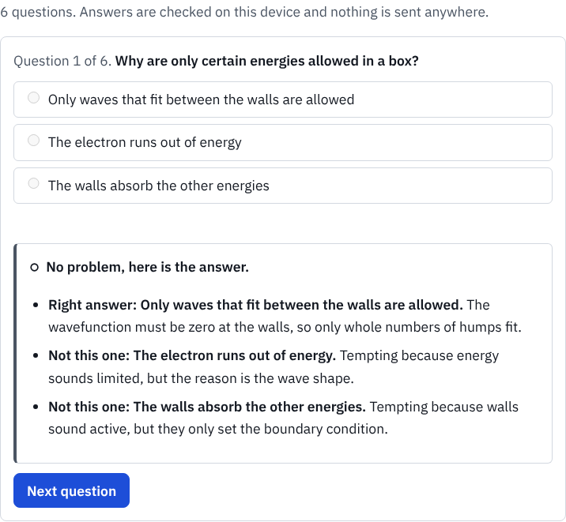
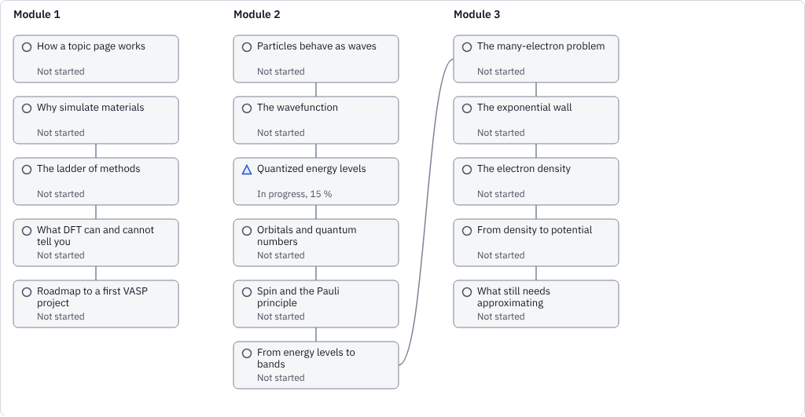

# M6.4 Practice UI, quizzes, mastery map and gentle gamification

Status: done        Branch: claude/great-dijkstra-oj0kbx        PR: see docs/PROGRESS.md

## What was built
- `Check` component (replaces the placeholder): static list with hints and answers in `
` without JavaScript; with JavaScript (`src/scripts/check.ts`, vanilla) one question at a time, hints on request, "I am not sure", explanations for every option after answering, a summary with the mastery estimate per topic concept, and the topic marked complete when all its concepts reach 0.95.
- `src/scripts/quiz-ui.ts`: the shared question renderer (single, multi, numeric, order with Up/Down buttons), native controls, focus moved to the feedback after answering.
- `src/stores/learner.ts` (zustand/vanilla): persisted learner state, `persisted` flag when storage is blocked, `recordAnswer` (BKT, Elo, SM-2, arm reward, delayed retention credit), export, import (validated, merged), reset, hide-streak setting.
- `/practice/`: session of up to 10 items chosen by the M6.3 policy, due-review count, "Why this question" text, topic suggestions with "Skip", stop at any time, "How this works" section.
- `/progress/`: mastery map as SVG laid out at build time (`mapLayout.ts`: one column per module, prerequisite edges), state by colour, shape (circle, triangle, square) and text; the same data in a table; module filter; gentle streak, milestones, hide-streak; export, import, reset with a confirmation dialog.
- `src/lib/learning/streak.ts` (gentle streak with one rest day in any 7), `catalog.ts` (published concepts, topic links, bank), `grade.ts` (grading split from the Zod schema so topic pages stay under 15 KB of JS).
- `.btn` styles moved from `Button.astro` to `base.css` so script-built buttons match. Header "Practice" now links to `/practice/`; the tools page cards are data driven.

 

## Gate results
| Gate | Result | Evidence |
|---|---|---|
| `npm run verify` | pass | 1217 unit tests; topic pages 11.07/15 KB JS, `/practice/` 11.44/200, `/progress/` 9.00/15 |
| E2E | pass | `practice.spec.ts` 14 tests (both projects); full suite 313 passed, 10 skipped; one convergence keyboard test timed out once and passed on re-run |
| axe | clean | `[data-check]`, `/practice/`, `/progress/` |
| Keyboard-only quiz | pass | e2e: arrow keys, Tab to "Check answer", Enter, focus on feedback |
| Storage blocked | pass | e2e with `localStorage` throwing: quiz works, notice shown on topic summary and `/practice/` |
| Clock | pass | Playwright clock: a wrong answer is due after a day; 4 days later it is offered first as "overdue for review" |
| Export, import, reset | pass | e2e round trip; a foreign JSON is rejected with a message |

## No dark patterns (checklist)
- [x] No timers anywhere; response time is used only to tune the picker and is never shown.
- [x] No leaderboards, no notifications, no badges for speed.
- [x] Streak tolerates one rest day in any 7 and never says "lost" or "broken"; with no streak the text invites, it does not scold.
- [x] Streak can be hidden (setting stored with the state).
- [x] "I am not sure" is always available and answered kindly ("No problem, here is the answer.").
- [x] Sessions are short (10 items) and can be stopped at any time without penalty.
- [x] Reset asks for confirmation and suggests exporting first; it is not hidden.

## Science traceability
| Item | Source ID | Test | Reference value origin |
|---|---|---|---|
| Models used by the UI | S-037, S-038, S-039 | M6.2/M6.3 unit tests | work order worked examples |

## Decisions made and open questions raised
No new D or Q entries (conventions are D-051 to D-053).

## Not done / deferred (be exact)
- Lighthouse was not run for `/practice/` and `/progress/` in this stage (M11.1 audits every route).
- No question bank uses `multi` or `order` yet; both render and grade (unit tests), but no e2e exercises them.

## For the author (actions needed)
- Try a practice session and the progress page and say if the tone fits.
